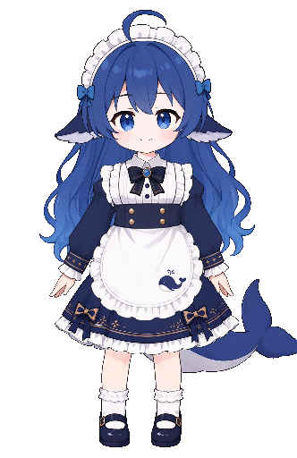

# ds-girl 鲸鱼女孩

[案例索引](../README.md) · [下载素材包](https://github.com/Ruka2/psd2live-examples/releases/download/ds-girl-assets-v1.0.0/ds-girl-1.0.0.zip) · [文件清单](manifest.json)

本案例素材为社区自发创作的 DeepSeek 形象「蓝色大肥鱼」，与 DeepSeek 官方没有联系。

鲸鱼女孩 Live2D 示例，包含完整 PSD2Live 工程和可用 VTube Studio 导出模型。模型具有基础九轴转头、眨眼张嘴差分，以及尾巴、领带和裙摆等部件的物理效果；并包含了用户与 Agent 在 PSD2Live项目上的协作过程。可用于在 PSD2Live 项目的人类与 AI 协作建模的操作参考。

## 环境与内容

- 素材版本：1.0.0
- PSD2Live：3.4.3（早期工程曾使用 3.0.1）
- 平台：macOS，MacBook Pro M3，源码编译运行
- AI 客户端与模型：Kimi Code，Kimi K3
- 素材包内容：
  - `psd-input/ds-girl.psd`：37 层规范命名的分层 PSD
  - `project/ds-girl.psd2live`：包含编辑历史的 PSD2Live 工程
  - `export/`：完整 VTube Studio 导出，包括 `.model3.json`、`.moc3`、`.vtube.json`、纹理、动作和物理文件

## 使用步骤

1. 下载并解压 `ds-girl-1.0.0.zip`。
2. **直接使用模型**：将 `export/` 整个文件夹放入 VTube Studio 的 `Live2DModels` 目录，可重命名为 `ds-girl-vts`。启动或重启 VTube Studio，在模型选择栏中选择 “DS Girl”。模型入口为 `export/ds-girl.model3.json`，需保留其引用的全部文件。
3. **继续编辑工程**：在 PSD2Live 中打开 `project/ds-girl.psd2live`。工程内已包含源素材和历史，不依赖原作者的本机路径。
4. **从 PSD 重新制作**：在 PSD2Live 中打开 `psd-input/ds-girl.psd`，再按所需预设和设置生成。重新生成的结果会随版本和设置变化，已有导出仅供展示。

## 已知问题

- 眨眼差分、高光和果冻眼等细节仍需人工检查与返工；未明确说明图层关系时，Agent 可能忘记隐藏原始眼睛。
- 工程经历 3.0.1 到 3.4.3 的跨版本编辑，曾在跨版本导出时遇到头发丢失和模型兼容问题；重新导出后应检查结果。
- 工程包含较多历史和视图记录，体积较大，打开、烘焙和加载可能较慢。
- 人工与 Agent 同时编辑可能产生冲突；Agent 操作期间建议暂停手工修改。更多主观反馈和排查经验见制作记录。

## 作者、来源与许可

- Live2D 建模贡献者：[Ruka2](https://github.com/Ruka2)
- 建模辅助：[PSD2Live](https://github.com/tsunehimatoi/psd2live)
- 原画与素材来源：原始参考来源[Earmer Carey](https://x.com/Liearmer/status/2087206380013023361)，并使用非 See-Through 生图模型辅助部件拆分，最终由 Agent 推理组装分层 PSD 拆分文件
- 许可：素材、工程及导出结果按 [CC BY-NC 4.0](https://creativecommons.org/licenses/by-nc/4.0/)（署名—非商业性使用 4.0 国际）发布，作者与来源信息保留在本说明和素材包中
- 许可特殊说明：禁止直接使用 「完整 VTube Studio 导出模型」进行直播活动，所导出的 VTS 仅用作导出操作的参考

详细制作过程、主观效果反馈、编辑历史统计与 Agent 使用经验见 [workflow/experience.md](workflow/experience.md)。
