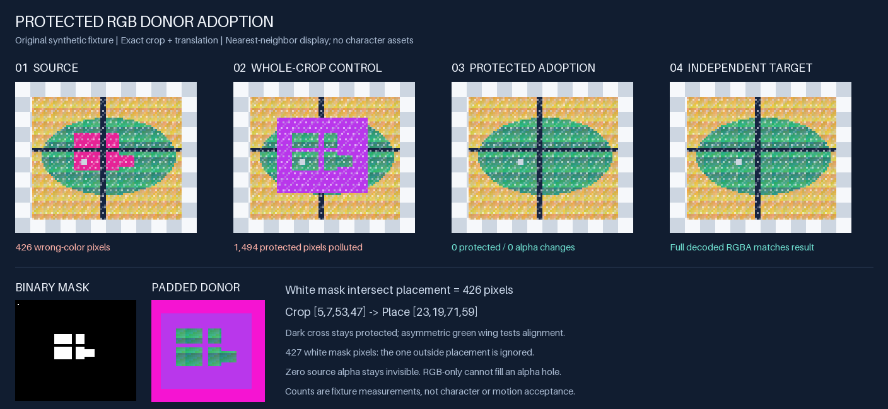

# Protected RGB donor adoption

[案例索引](../README.md) · 投稿者 [@a1232261](https://github.com/a1232261)（[Issue #2](https://github.com/tsunehimatoi/psd2live-examples/issues/2)，ChatGPT/Codex 协作整理）· 程式与文件 MIT、fixture 与衍生 PNG CC0-1.0，见下方[逐項許可](#逐項許可)

本次可執行驗證為**原創自製 fixture**；未在本次重跑完整角色或 PSD2Live。這個小工具針對已有可接受 alpha 的 PNG 圖層，只在明確允許的位置採用 donor 的 RGB，保留全部來源 alpha 與保護區像素。



## 能直接使用什麼

`workflow/adopt_donor.py` 是單一離線 CLI，依賴 Python 標準函式庫與 Pillow。輸入既有圖層、donor、二值 mask、精確裁切與放置矩形；輸出 adopted PNG、採用區預覽與可讀 JSON 紀錄。它不推導新 matte，不自動配準或生成內容。

## 環境與執行

本次實測：Python 3.14.7、Pillow 12.3.0。依賴固定在 [requirements.txt](requirements.txt)；未聲稱測過其他 Pillow 版本或 PSD2Live 版本。下列命令從本案例目錄執行：

```sh
python -m pip install -r requirements.txt
```

已有相符 Pillow 的離線環境可以直接執行。第一個輸出目錄必須尚不存在；`results/` 已隨範例提供。

```sh
python workflow/adopt_donor.py --source fixtures/source.png --donor fixtures/donor-padded.png --mask fixtures/mask.png --mask-convention white-edit-black-protect --donor-crop 5 7 53 47 --place 23 19 71 59 --out-dir results/my-adoption
```

預期標準輸出：`{"status": "OK", "allowed_pixels": 426, "actual_rgb_changed_pixels": 426}`。

- `results/my-adoption/adopted.png`：原圖尺寸 96×80、RGBA；與獨立定義的 `fixtures/expected.png` 解碼後完全相同。
- `adoption-preview.png`：棋盤底上的結果，青色半透明覆蓋標出**實際採用集合**，僅供解讀，不是正式輸出。
- `adoption.json`：三個輸入與兩個輸出 PNG 的 SHA-256、尺寸、矩形、mask 慣例與實測計數；不記絕對路徑。JSON 不包含自身雜湊。

重複執行請選新的輸出目錄。既有輸出目錄及輸入檔案都不會被覆寫。

## 精確契約

座標統一為整數 `left top right bottom`：左／上含、右／下不含。donor 裁切 `[5,7,53,47]` 為 48×40；放置 `[23,19,71,59]` 同為 48×40。只裁切和平移，不縮放、不猜 padding、不做 ECC/SIFT、羽化或色彩匹配。

mask 必須是與來源同尺寸的 **8-bit L PNG**，僅含 `0` 與 `255`。`255` 白色允許編輯；`0` 黑色保護；CLI 必須明示 `--mask-convention white-edit-black-protect`。歷史 alpha0 可編輯／alpha255 保護的 mask，必須先明確取出該 alpha 並二值反相成這個 L 慣例；不可直接傳入、猜測亮度或將灰階暗中羽化。

真正可採用集合是「放置矩形 ∩ mask 白色」。fixture 有 427 個白點，其中一點在放置矩形外；因此只有 426 個採用像素。所有其他像素的**完整解碼 RGBA** 保持來源值，包括 alpha=0 像素的隱藏 RGB。來源 alpha 在整張圖都保持原值。

來源和 donor 限 **encoded PNG header 為 8-bit RGB／RGBA、非交錯式**；在 Pillow 解碼前檢查位元深度和 color type，避免將解碼後的 RGB 誤認為原檔就是 8-bit。限制每張圖不超過 40,000,000 像素；不支援 palette、16-bit、tRNS、APNG、EXIF，或 iCCP/sRGB/gAMA/cHRM/cICP/mDCV/cLLI 色彩描述。未知 critical chunk 也會拒絕。輸出不攜帶輸入 metadata。

「不改色彩」是數值 RGB 的精確複製，沒有套用色彩空間轉換；這不是完整色彩管理。實際被採用的 donor 像素 alpha 必須全部為 255；未採用的 donor 像素可透明，內容一律忽略。

輸入錯誤、矩形越界／尺寸不合、mask 不合／非二值、零採用區及採用像素不透明要求失敗，會非零退出，不發布成功輸出。完整輸出先寫在暫存目錄，驗證與寫入成功後才發布。

## 本次實測與污染對照

fixture 是不對稱色塊、紋理及跨界深色十字；來源含部分透明、完全透明與已知錯色區。donor 有顯眼 padding、正確補色及故意改錯的保護區。獨立目標直接由幾何定義產生，不呼叫被測採用函式。人工可查的面積為 `24×20 − 3×20 − 2×24 + 3×2 + 8×6 = 426`。

| 測量 | 受保護採用 | 同 donor 整塊貼回的對照 |
| --- | ---: | ---: |
| 預期採用位置 RGB 變更 | 426 | 426 |
| 保護區 RGBA 變更 | 0 | 1,494 |
| 來源 alpha 變更 | 0 | 0 |
| 與獨立目標全圖 RGBA 相同 | 是 | 否 |

對照也保留來源 alpha，讓污染差異只來自 RGB 採用範圍。1,494 是 **48×40 放置區內、mask 黑色部分**的 donor RGB 與來源差異；不假稱知道 padding 或放置區外的完整畫布對應。

保存的 [正常輸出](results/demo/adoption.json)、[對照結果](results/comparison.json) 與 [驗證結果](results/verification.json) 可直接查閱。重新執行驗證：

```sh
python workflow/verify_demo.py --report results/my-verification.json
```

測試真正呼叫 CLI，核對獨立目標、全部像素、已知計數、乾淨輸出重播、RGB/RGBA 支援，以及錯誤尺寸／越界／非二值或錯尺寸 mask／半透明採用 donor／零採用區／encoded RGB16／色彩 metadata／損壞 PNG／錯 mask 慣例／覆寫拒絕。拒絕案例都檢查沒有成功產物。

fixture 可在新目錄重新產生：`python workflow/make_fixtures.py --out-dir fixtures-regenerated`。產生器不依賴採用工具。`make_preview.py` 根據保存的 `results/demo` 產生預覽與整塊貼回對照，並檢查目標一致及污染計數。

## 實際使用的限制與經驗

- 真正 alpha=0 的缺口，換 RGB 後仍不可見；需要另行完成 alpha／ownership。舊 alpha 錯誤也會被完整保留。
- donor 內容品質與定位是兩個門檻。方向、比例、身份或語意錯誤，不能靠這個工具修正。
- 允許區內仍可能不好看。像素保護通過，不能代替正常觀看尺寸及同條件動作驗收。
- 參考圖 I/O 在推論前失敗、推論完成但候選拒用，以及候選局部採用，應分別記錄。沒讀到參考圖不能當成模型畫質失敗。
- 這個 fixture 不證明角色動態自然、完整製作流程已完成或新版 PSD2Live 相容。它補充既有生成拆層／配準／遮擋案例；沒有宣稱那些案例缺少補全能力。

歷史局部試作的原保存報告曾記錄 140,628 個 RGB 採用像素、961,067 個區外變更被拒用。這些是已查到的**歷史紀錄**，不是本次重測；本次實測數字只有上表的合成 fixture。舊腳本依賴私有角色流程與第三方 adapter，本工具為依契約新寫的獨立實作，沒有複製其函式。角色素材權利未在本次確認，因此投稿包不含角色圖、prompt、PSD 或工程。來源界線見 [SOURCES.md](SOURCES.md)。

## 逐項許可

| 內容 | 許可 |
| --- | --- |
| `workflow/*.py`、requirements、README、SOURCES、NOTICE、實測 JSON | MIT，見 [LICENSE](LICENSE) |
| `fixtures/*.png`、fixture 幾何規格 `expected.json`、`preview.png`、`results/**/*.png` | 原創自製，CC0-1.0，見 [LICENSE-CC0.txt](LICENSE-CC0.txt) |

兩種許可明確限定上述範圍；不將倉庫預設 CC0 套到第三方程式或舊角色。Pillow 是外部安裝依賴，未隨包重分發。沒有模型、SDK、憑證、私有路徑或 session ID。此目錄為工具／流程投稿，不是素材 Release 或角色資產清單。
