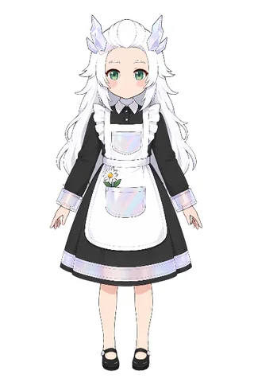
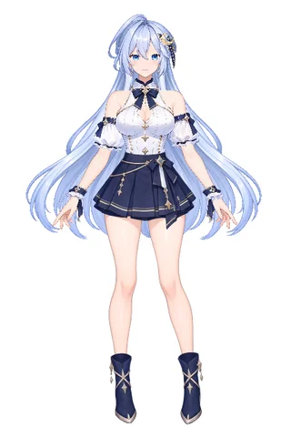
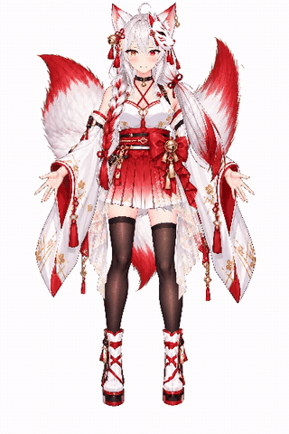
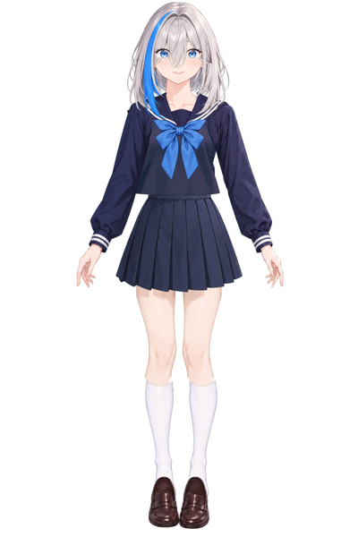
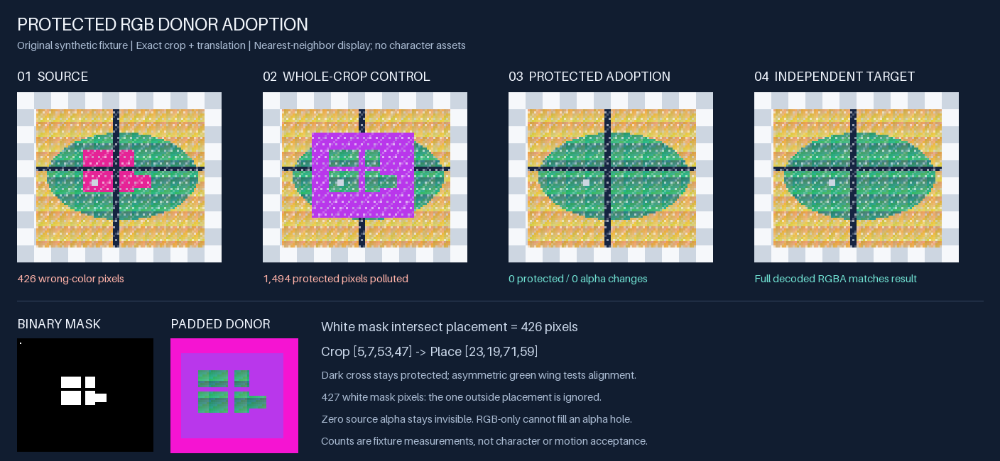

# ケース一覧

[中文](../../cases/README.md) · [English](../en/CASES.md) · [한국어](../ko/CASES.md)

[トップ](README.md) · [ケース投稿](https://github.com/tsunehimatoi/psd2live-examples/issues/new/choose) · [投稿ガイド](CONTRIBUTING.md)

<table>
<tr>
<td width="33%" valign="top" align="center">
 
<b><a href="../../cases/tml/README.md">tml</a></b> 
レイヤー分け PSD の読み込み、自動生成、書き出し PSD2Live 0.1.0 · 入門、生成、書き出し
</td>
<td width="33%" valign="top" align="center">
 
<b><a href="../../cases/ds/README.md">ds</a></b> 
モーションと物理を含む完成キャラクター PSD2Live 0.1.0 · 生成、モーション、物理
</td>
<td width="33%" valign="top" align="center">
 
<b><a href="../../cases/star_lan/README.md">star_lan</a></b> 
関節の変形、複数テクスチャ、AI との協働ノート PSD2Live 3.2.0 · スケルトン、テクスチャ、MCP
</td>
</tr>
<tr>
<td width="33%" valign="top" align="center">
 
<b><a href="../../cases/hiakari-inori/README.md">緋灯祈（Hiakari Inori）</a></b> 
grok bot + GPT Image、see-through なしの分割と複雑なシミュレーション PSD2Live 3.4.2 · 分割、シミュレーション、grok
</td>
<td width="33%" valign="top" align="center">
 
<b><a href="../../cases/kirishima-mio/README.md">霧島澪（Kirishima Mio）</a></b> 
緋灯祈の前段の試み：生成レイヤー、位置合わせ、隠れ部分の補完 PSD2Live 3.4.2 · レイヤー、位置合わせ、grok
</td>
<td width="33%" valign="top" align="center">
 
<b><a href="../../cases/ds-girl/README.md">ds-girl</a></b> 
AI との協働の記録を含む完全なキャラクター、see-through なしの分割（中国語のみ） PSD2Live 3.4.3 · 人と AI の協働、実践ノウハウ
</td>
</tr>
<tr>
<td width="33%" valign="top" align="center">
 
<b><a href="../../cases/protected-rgb-donor-adoption/README.md">protected-rgb-donor-adoption</a></b> 
マスクで許可した領域だけ donor の RGB を採用し、alpha と保護領域を保持（中国語のみ） PSD2Live では未検証 · スクリプト、マスク、色差し替え
</td>
<td width="33%"></td>
<td width="33%"></td>
</tr>
</table>

各ケースのページは投稿者の言語で書かれています。プレビューの作り方は [投稿ガイド](CONTRIBUTING.md#プレビュー) を参照してください。
